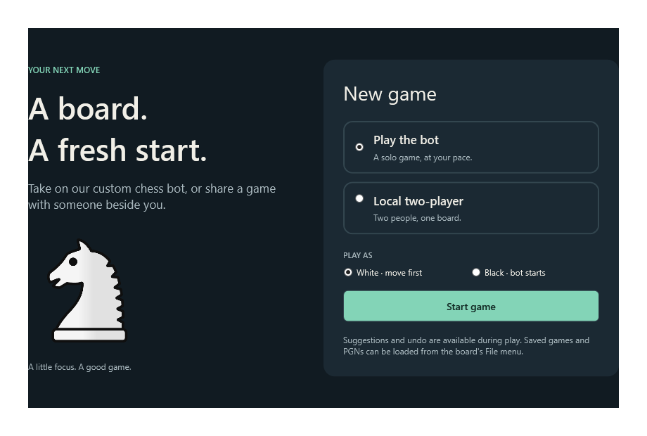
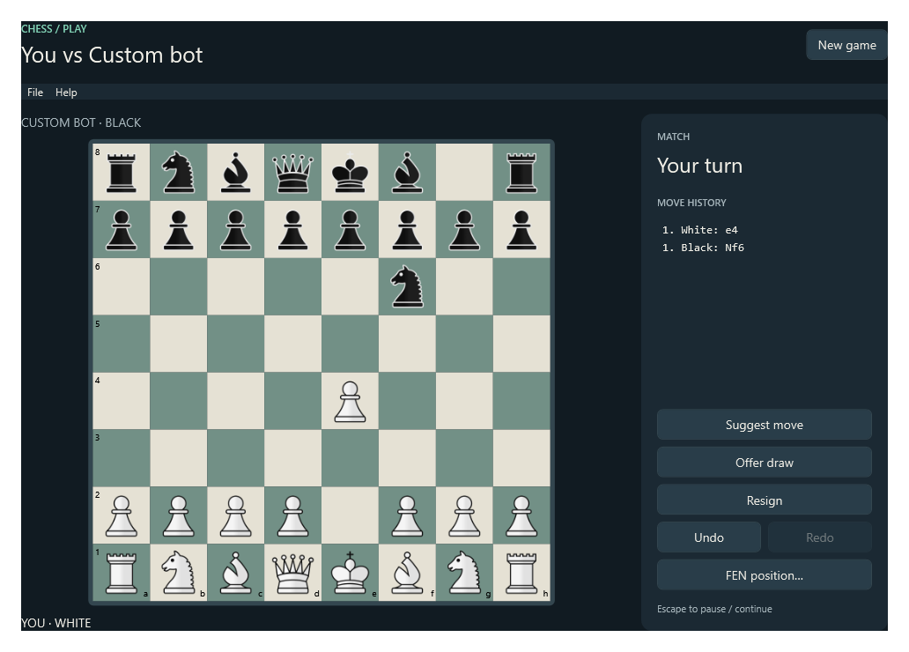

# Chess

A Windows chess application built with C#, .NET 10 LTS, and WPF. Play against a
custom-built bot or share the board in local two-player mode. The Tournament UI
uses a charcoal gradient, restrained brass accents, and a traditional move scoresheet.

| Start a game | Play against the bot |
| --- | --- |
|  |  |

The original foundation follows [OttoBotCode's chess tutorial](https://www.youtube.com/@OttoBotCode).

## Playing

Choose **Computer** or **Local two-player** on the start screen. In a computer game,
choose White or Black and select **Take White & play** or **Take Black & play**.
The board faces your side, and the bot moves automatically on its turns.

Choose **Play online** to create or join a private room with a Windows or browser
opponent. [Windows online controls and recovery](docs/windows-online.md).

- Click a piece, then a highlighted destination. Promotion offers all four choices.
- **Suggest move** highlights a recommendation without playing it.
- **Escape** pauses or continues. **Help → Cancel thinking** stops a search;
  **Resume bot** continues a stopped bot turn.
- **Undo** / **Ctrl+Z** and **Redo** / **Ctrl+Y** navigate history. Bot games group
  your move and the reply into a round; local games navigate one action at a time.
- **Open saved game** resumes a complete save from setup. The File menu also
  supports saving/loading games and importing/exporting PGN; **Load FEN** opens the position editor.

Saved chess files use the mode and colour selected in the current UI. Choose those
settings before loading a match. See [gameplay controls](docs/gameplay.md) for draw
claims, offers, resignation, and history behavior.

## The custom bot

The bot is implemented in this repository, without an external engine or online service.
It searches legal moves and replies using iterative-deepening negamax and alpha-beta
pruning, then scores material and piece placement. The current baseline searches up
to three plies within a 4,000-visit budget, using the last completed iteration.
It handles promotions, draw claims, and responses to draw offers.

This is a starting engine with no difficulty selector or strength rating; it can miss
tactics beyond its search horizon. [Read how the bot works](docs/bot.md).

## Build and run

Install [.NET SDK 10.0.404 or a newer .NET 10 SDK](https://dotnet.microsoft.com/download/dotnet/10.0) on Windows.
Install [Node.js 24 LTS](https://nodejs.org/) to build the browser assets used by the server.
From the repository root:

```powershell
npm ci --prefix src/Chess.Web --ignore-scripts
dotnet restore src/Chess.sln
dotnet build src/Chess.sln --configuration Release
dotnet run --project src/ChessUI/ChessUI.csproj
```

Alternatively, open `src/Chess.sln` in a Visual Studio version supporting .NET 10
with the **.NET desktop development** workload, and select `ChessUI` as the startup project.

The rules and search live in `src/ChessLogic`; the desktop interface lives in
`src/ChessUI`. Libre Baskerville and IBM Plex fonts are bundled with their license
notices, so the interface does not depend on installing those fonts separately.

## Online multiplayer development

The [browser client](docs/browser-play.md) now supports private online games with
invitation links, reconnect/resume, promotions, draw actions, and resignation.
It uses the same custom C# rules as the desktop app. Run the server, open its URL,
and share a room invitation with someone who can reach that server.

```powershell
npm ci --prefix src/Chess.Web --ignore-scripts
dotnet run --project src/Chess.Server/Chess.Server.csproj --urls http://127.0.0.1:5080
```

Open **http://127.0.0.1:5080** locally. The published Linux server archive includes
all browser assets; players need only a browser. Windows players can use **Play
online** to join the same rooms. Localhost links work only on your computer.
See the [server contract](docs/multiplayer-server.md) and [multiplayer plan](docs/online-multiplayer-plan.md).

CI validates desktop/server tests, browser recovery logic, and real two-browser games.

## Features

- Board rendering and legal-move highlights
- [Tournament interface](docs/tournament-design.md), based on the approved Figma C design
- [Custom chess bot](docs/bot.md): automatic opponent mode, colour selection, and move suggestions
- Turn tracking and king-safety validation
- Castling, en passant, and all four promotion choices
- Checkmate, stalemate, and basic insufficient-material detection
- Pause, restart, and rematch menus
- [Contextual draw claims and draw offers](docs/draws.md), with accept/decline controls
- [SAN notation and PGN import/export](docs/pgn.md) for exchanging games with other tools
- [Save and resume complete games](docs/saved-games.md), including undo/redo history
- [Undo and redo](docs/undo-redo.md), including finished games and special moves

See [gameplay controls and validation](docs/gameplay.md) for draw claims, move history, resignation, and tests.

## Tests

```powershell
dotnet test src/Chess.sln --configuration Release -p:TreatWarningsAsErrors=true
```

The suite covers chess rules, tactical bot decisions, complete
saves and PGN, and WPF interactions such as automatic replies, suggestions, pause,
undo/redo, setup navigation, bundled fonts, and layout at smaller window sizes.
Server tests additionally exercise actual SignalR clients, seat credentials, room
isolation, authoritative moves, reconnects, expiry, and request limits.

## Validation and delivery

Pull requests to `main` and pushes to `main` run the GitHub Actions workflow:

1. Restore and build the solution on Windows.
2. Run all test projects in the solution and upload TRX results when available.
3. Publish and upload `Chess-win-x64.zip` as a workflow artifact.

The ZIP contains a self-contained Windows x64 build, so players do not need to install .NET.
Extract the full archive and run `ChessUI.exe`.

To publish a GitHub Release after merging and checking CI, tag a commit on `main`:

```powershell
git switch main
git pull --ff-only
git tag v0.1.0
git push origin v0.1.0
```

The tag workflow builds and validates the application before publishing the ZIP and
generated release notes. Tags outside `main` are rejected. No signing credentials are configured.
Use a new version tag for each release.

The `Windows build and tests` check is required before merging into `main`.

## Public hosting

A [free Render deployment guide](docs/public-hosting.md) includes the Docker image,
Blueprint setup, HTTPS-origin configuration, and free-tier room-reset behavior.
