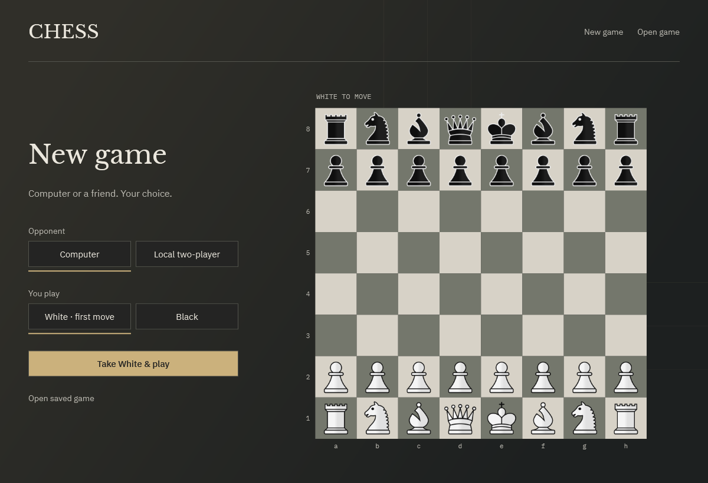
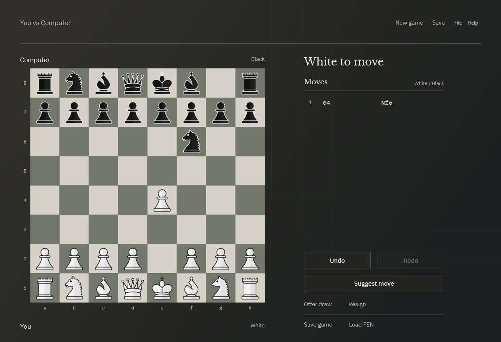
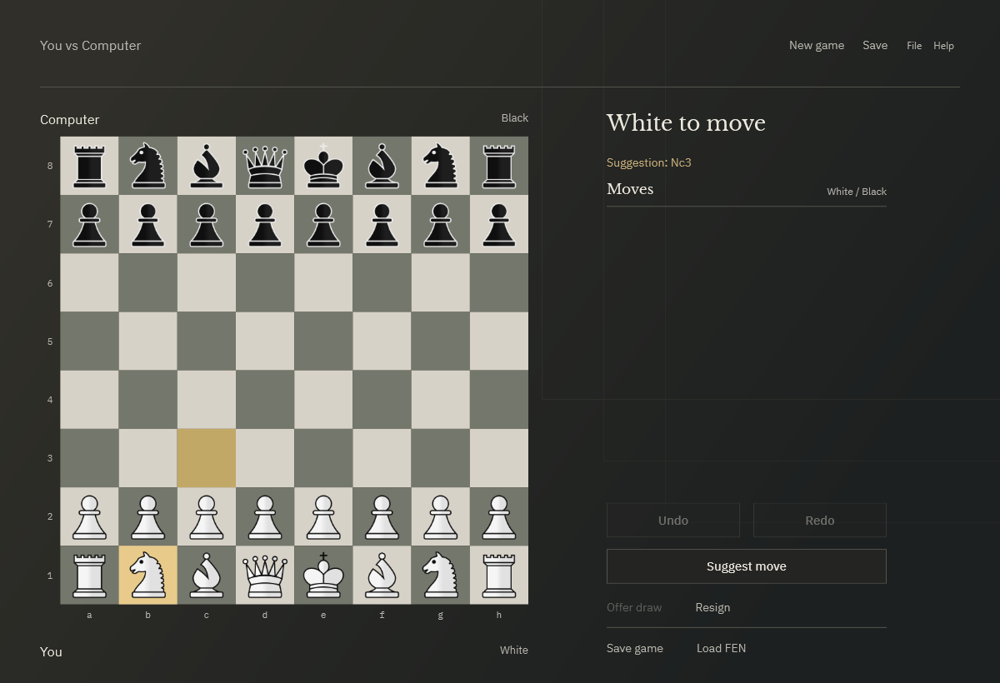

# Play our custom chess bot

Choose **Computer** on the start screen, select White or Black, and press
**Take White & play** or **Take Black & play**. The board faces your side. White moves first: if you choose Black,
the bot opens automatically. After each of your moves, it searches and replies on
its own. Human input is restricted to your turn. **Local two-player** keeps both
sides under human control. **New game** returns to setup and discards the current
session; save first if you want to keep it. Rematch keeps your mode and colour.
**Open saved game** on setup resumes a complete save in the chosen mode.

The search runs in the background. **Escape** pauses a bot match and cancels pending
thinking. Continue resumes play. **Help → Cancel thinking** stops a search without
opening the pause menu; **Resume bot** continues a stopped bot turn. Undo can cancel
an in-flight reply. Board actions and file operations are disabled while thinking.
Closing the window or replacing the position discards pending results.

## Suggestions

**Suggest move**, also available under **Help**, runs the same engine for the current
human side. It shows SAN notation and highlights the source and destination in gold,
without playing a move or changing the save/undo timeline. It can recommend a draw
claim or accepting an offer too. Suggestions work in both modes, on human turns.
In local mode Escape cancels a suggestion without opening the pause menu.

## How it chooses a move

The search and scoring are implemented here in C#, in `ChessLogic/ChessBot.cs`.
There is no external engine, opening book, network service, or trained model.
It reuses this project's legal-move generation and game rules.

1. **Copy the position.** Keep the real game untouched while exploring. The copy
   includes repetition counts, move counters, and pending draw offers.
2. **Try legal moves.** For each move, search the opponent's replies and our responses.
   One move by one player is one *ply*. A depth of three means our move, their reply,
   then our next move.
3. **Score the leaves.** Material is measured in hundredths of a pawn: pawn 100,
   knight 320, bishop 330, rook 500, queen 900. Small bonuses reward pawn advancement
   and central squares for pawns, knights, and bishops. The score is relative to the
   player whose turn it is at that position. Checkmate overrides material; quicker
   mates and longer resistance to a forced loss are preferred. Draws score zero.
4. **Assume the opponent chooses their best reply.** Negamax implements this by
   negating each child's score. A tempting capture can be rejected when the opponent
   can win the capturing piece on the next move.
5. **Skip branches that cannot improve the answer.** Alpha-beta pruning uses scores
   already found to stop exploring inferior alternatives. Captures and promotions
   are searched first to help it find useful bounds sooner.
6. **Deepen gradually.** Search depth one, then two, then three. The default budget
   is 4,000 counted search visits across all iterations. If it runs out, keep the
   last fully completed depth. If even depth one cannot finish, use the first legal
   move in capture/promotion order.

For example, taking a pawn initially gains 100 points, but if the opponent can then
capture our rook, the two-ply search sees the larger loss and can choose another move.

## Draws, history, and saves

A valid current or intended-move draw claim is another zero-score choice. The bot can
claim instead of continuing a losing line, or continue when it finds something better.
It accepts an opponent's pending offer when a completed search scores the position
at zero or below; otherwise its move declines the offer through the normal rules.
It does not initiate offers or resign in this version.

The selected action is applied through the normal game methods, so SAN history,
undo/redo, draw handling, complete saves, and PGN work as they do for human actions.
The bot's search tree is temporary and is not stored in a save file.

In a bot match, Undo normally takes back your move and the reply together. Redo
restores that round. If history navigation leaves the bot to move, automatic play
waits for **Resume bot** so you can inspect the position. A fresh human move resumes
normal replies. Local mode still navigates one action at a time.

Load saves, PGNs, and FEN positions from the game screen. They use the selected mode
and human colour; a loaded bot turn starts automatically. Complete saves store chess
actions rather than the UI's mode/colour choice, so choose the desired mode before
loading a saved match. Offer a draw before your move; the bot responds on its turn.

## Current limits and next steps

This is a deterministic baseline, not a rated engine. Its score is a rough evaluation,
not a winning probability. A node budget bounds search visits, not elapsed time;
cost varies with the position and computer. Cancellation is checked during search.

The shallow horizon can miss tactics just beyond its depth. There is no quiescence
search, transposition table, advanced king safety, or endgame knowledge yet. Next steps
are quiescence search to finish tactical exchanges before scoring, and faster search
to support deeper difficulty levels. The search strength is unchanged by automatic mode.

Tests cover mates for both colours, captures and defended pieces, promotion, draw
choices, bounded search, cancellation, snapshot isolation, automatic replies, both
orientations, start-screen navigation, suggestion isolation, and WPF history integration.
