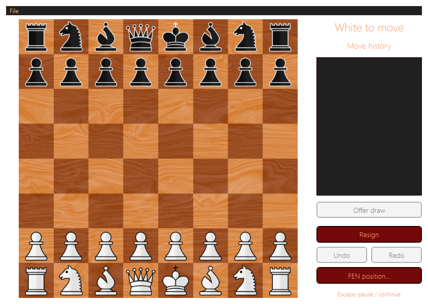
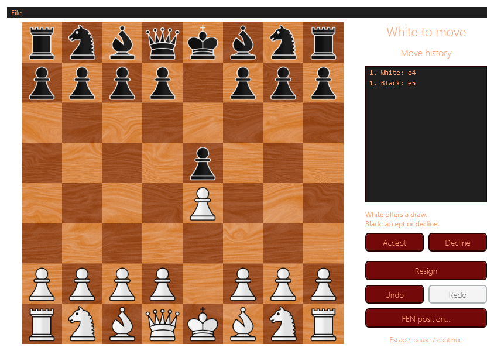

# Draw claims and offers

Screenshots and history/file controls here describe offline Windows play. The same
chess rules apply online, where actions are server-validated and local undo is
unavailable. See [browser play](browser-play.md) and [Windows online play](windows-online.md).

## Claims appear when they are useful

The normal board hides **Claim draw** and **Claim with next move**.
**Claim draw** appears when the current position qualifies under threefold repetition or
the fifty-move rule. If the current position does not qualify but a legal move would,
**Claim with next move** appears instead. Select it, then choose the intended move.
An invalid choice leaves the game unchanged and shows a short hint.

The normal controls return after undoing or loading a different position. Claim controls
are hidden after a game ends; automatic fivefold and seventy-five-move draws still apply.

## Offering a draw

**Offer draw** is available from move 2, once both players have made a move. Imported FEN
move counters are respected. The disabled button's tooltip explains the initial restriction.
The panel names the offering player and the opponent who can **Accept** or **Decline**.

An offer can be made on your turn before moving. The opponent may respond immediately,
or you can finish your move and leave the offer open. Playing the opponent's next move
declines it automatically. The offerer cannot accept or decline their own offer, withdraw
it through a response, or make a second offer while one is pending.
Agreement and offer handling follow [FIDE Articles 5.2.3 and 9.1.2](https://handbook.fide.com/chapter/E012023).
This local app treats a completed opponent move as implicit decline; clicking a piece
without completing a move does not decline an offer.

Accepting ends the game as **Draw by agreement**. Declining leaves the board and turn
unchanged. A resignation, valid claim, or automatic game ending clears outstanding offers.
Offer/response controls are disabled behind pause, promotion, FEN, and result menus.

## History and files

Offers and explicit responses are undoable actions; they do not add chess moves or count
as repeated positions. Undoing acceptance restores the pending offer, and undoing an
opponent move restores any offer that move declined. A new action discards the redo branch.

Complete saves containing offer actions use JSON version 3 and preserve pending offers,
responses, and their redo history. Versions 1 and 2 remain readable. Each offer or response
counts toward the existing 1,024-action save limit.
FEN does not store offers. PGN exports the agreed draw result but does not retain the offer
or response actions; importing that outcome labels it as a recorded PGN result.

The model exposes `CanOfferDraw`, `DrawOfferedBy`, `OfferDraw()`,
`CanRespondToDrawOffer(player)`, `AcceptDraw(player)`, and `DeclineDraw(player)`.
`CanClaimDrawWithIntendedMove()` checks whether any legal move would qualify for a claim.
