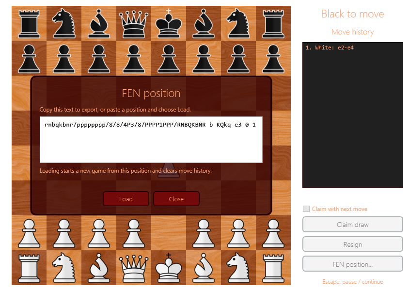

# FEN positions



Choose **FEN position…** in the side panel. The dialog contains the current position;
select the text and copy it to export. To import, paste a complete FEN and choose **Load**.
An invalid position shows an error and leaves the current game unchanged.
**Close** or Escape returns to the previous board, pause menu, or result menu.
FEN controls are unavailable while choosing a promotion piece.

Loading replaces the current game, clears selection and move history, and restores the
side to move, castling rights, en passant target, half-move clock, and full-move number.
Already terminal positions show their result immediately. Move-history numbering starts
at the imported full-move number, including when Black moves first.

## Format

A position has six fields: pieces, active colour, castling availability, en passant target,
half-move clock, and full-move number. Output uses one space between fields and canonical
`KQkq` order. The target square is exported after every double step, even if en passant
cannot be played. This follows the [FEN specification, section 16.1](https://www.saremba.de/chessgml/standards/pgn/pgn-complete.htm#c16.1).

Initial position:

```text
rnbqkbnr/pppppppp/8/8/8/8/PPPPPPPP/RNBQKBNR w KQkq - 0 1
```

Input may contain surrounding whitespace or tabs between fields. Castling letters may
be supplied in any order, but must be unique. Ranks must use a single digit for each
consecutive run of empty squares.

## Validation and limits

- Exactly eight ranks of eight squares and one king per side.
- No pawns on the first or eighth rank; no more than eight pawns or sixteen pieces per side.
- Castling rights require a matching king and rook on their starting squares.
- An en passant target must match an opposing double step: correct rank, empty target and origin, opposing pawn at its destination, and zero half-move clock. No capturing pawn is required.
- The side that just moved cannot be in check; this also rejects adjacent kings.
- Half-move clocks range from 0 to 2,147,483,647; full-move numbers are positive `BigInteger` values. Input is limited to 1,024 characters and printable ASCII fields.

Validation checks position consistency, not whether an entire legal game can reach the position.
Only standard chess castling is supported, not Chess960.

FEN stores a position, not prior moves, repetition history, resignation, or draw claims.
Import starts a fresh repetition count at one. A claimed or resigned game can therefore
be exported as a position and loaded as a new game. Saving complete games and PGN remain separate work.

## Code API

```csharp
GameState game = GameState.FromFen(Fen.InitialPosition);
string position = game.ToFen();

if (Fen.TryParse(input, out GameState? loaded, out string? error))
{
    // Replace the current game only after validation succeeds.
}
```

`Fen.Parse` throws `FormatException` for invalid input and `ArgumentNullException` for null.
`Fen.TryParse` returns a readable error without changing an existing game.
