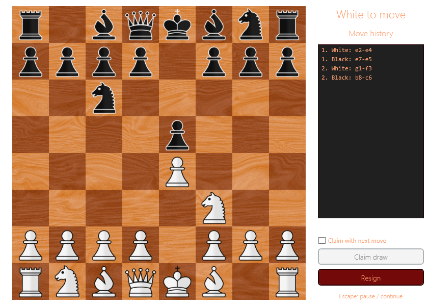

# Gameplay and validation



## Controls

- Click a piece, then a highlighted destination. Clicking another movable friendly piece changes the selection.
- Choose a queen, rook, bishop, or knight to complete promotion. Escape cannot cancel that choice.
- Escape opens or closes the pause menu. A completed game stays on its result menu until rematch or exit.
- The side panel shows whose turn it is, check status, and move history in coordinate notation.
- **Resign** ends the game for the player whose turn it is. A bare opposing king cannot receive a win, so that case is a draw.
- **Claim draw** becomes available when the current position qualifies for threefold repetition or the fifty-move rule.
- To claim based on an intended move, check **Claim with next move**, then select that move, including a promotion choice if needed. A successful claim ends the game before the move is played. An invalid claim leaves the board unchanged; clear the checkbox to resume normal play.

## Rules

En passant is available only on the immediate reply to a double step. Copies of a board preserve that opportunity.
Castling requires the king and a friendly rook on their starting squares, with neither having moved, an empty path, and no check on the king's starting, transit, or destination squares.

Repetition tracking includes the side to move, castling rights, and en passant only when that capture is legal.
The initial position counts as its first occurrence. Captures and pawn moves reset the half-move clock.

Threefold repetition and fifty moves per side are claimable draws. Fivefold repetition and seventy-five moves per side end the game automatically; checkmate on the final move takes precedence.
These distinctions follow [FIDE Laws of Chess, Articles 9.2–9.6](https://handbook.fide.com/chapter/E012023).

Material detection covers king versus king, king and bishop versus king, king and knight versus king, and one bishop per side on the same square colour. General dead-position detection, clocks, draw offers, undo, saved games, PGN, and an AI opponent are outside this implementation.
Move history is kept in memory and resets on rematch; its notation is descriptive, not SAN or PGN.

## Run the regression suite

On Windows with the .NET 10 SDK:

```powershell
dotnet test src/Chess.sln --configuration Release --logger trx --results-directory TestResults
```

The suite checks legal-move boundaries, en passant expiry and pinned captures, castling, all promotion choices,
material detection, checkmate, stalemate, move history, resignation, draw thresholds, and routed WPF menu events.
Move generation is checked against initial-position counts of 20, 400, and 8,902 nodes and Kiwipete counts of 48 and 2,039 nodes.

The tests use an STA dispatcher for WPF and do not require mouse or keyboard interaction.
Pull requests and pushes to main run the suite through GitHub Actions.
