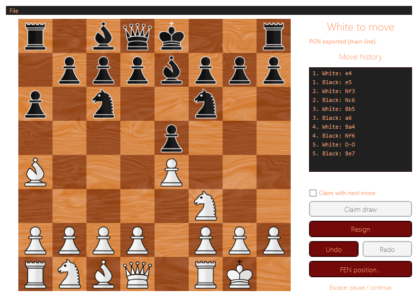

# SAN notation and PGN exchange

Move history now shows Standard Algebraic Notation: `Nf3`, `exd5`, `O-O`, `e8=Q+`, and `Qh4#`.
Disambiguation uses only legal alternatives, so a pinned piece does not create ambiguity.
Check and checkmate suffixes describe the board, including moves that also trigger an automatic draw.

Use **File → Import PGN…** or **File → Export PGN…** for `.pgn` files. Import replaces the game
only after the entire main line has been validated. Invalid input leaves the current game unchanged.
File controls are disabled during promotion and FEN editing; pause and result menus support them.

Exports contain the seven standard headers, preserved supplemental headers, canonical SAN, the
current result marker, and `SetUp` / `FEN` for a custom starting position. Black-to-move starts
retain their full-move numbers. Movetext is wrapped at 80 columns where token boundaries permit.
The conventions follow the [PGN specification](https://www.saremba.de/chessgml/standards/pgn/pgn-complete.htm).

## Import support

- One standard-chess game and its main line per file. Multiple games and Chess960 variants are rejected.
- Canonical SAN, zero-based castling (`0-0`), omitted check suffixes, and traditional `!` / `?` annotations.
- Supplied check/mate suffixes must be correct. Ambiguous moves and noncanonical long-coordinate notation are rejected.
- Move numbers can be attached or separated, with import-format dot punctuation (including `42. ... Nf6`). Numeric move numbers must match the position.
- Brace and semicolon comments, escaped `%` lines, NAGs `$0`–`$255`, and nested variations are skipped.
- Quoted header values support escaped quotes and backslashes. Headers survive later export and complete-game saving.
- Custom starts require both `SetUp "1"` and `FEN` headers. Contradictory headers, termination markers, and automatic board results are rejected.

Comments, NAGs, and variations are not retained or re-exported. Only the current main line is
exported; undone future moves are excluded. Use [complete-game saves](saved-games.md) to retain redo history.
Files are limited to 1 MiB and 1,024 actions; tag names and values are limited to 255 characters,
and variations can nest at most 64 levels deep.

A result marker alone does not prove resignation or a draw claim. When the final board is not
already terminal, the imported outcome is labelled **recorded result** and becomes its own undoable
action. The application does not invent a resignation reason. Export recomputes the current result,
so undoing an ending does not leave a stale Result header in the exported game.

## Code APIs

`San.Format(game, move)` and `San.Parse(game, text)` operate without playing a move. Played moves
store canonical text in `MoveRecord.San`; `ToString()` retains the earlier coordinate representation.
`Pgn.Parse` / `Pgn.Format` exchange text; `Pgn.Load` / `Pgn.Save` exchange files with atomic writes.
Malformed text throws `FormatException`. PGN header metadata is exposed through `GameState.PgnTags`.

Complete saves with PGN metadata or recorded outcomes use JSON version 2. Version 1 saves remain
readable; ordinary native games without those additions still use version 1.
