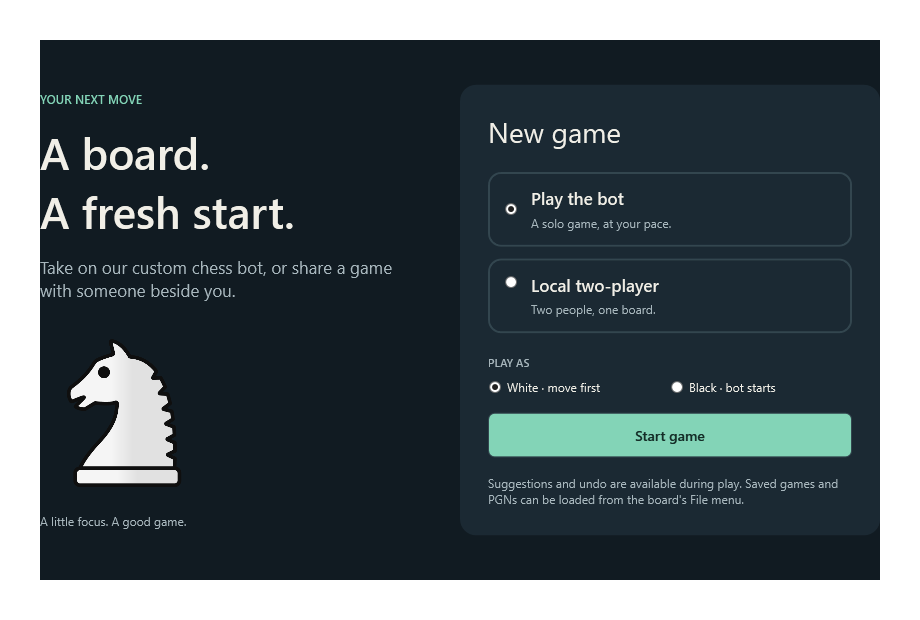
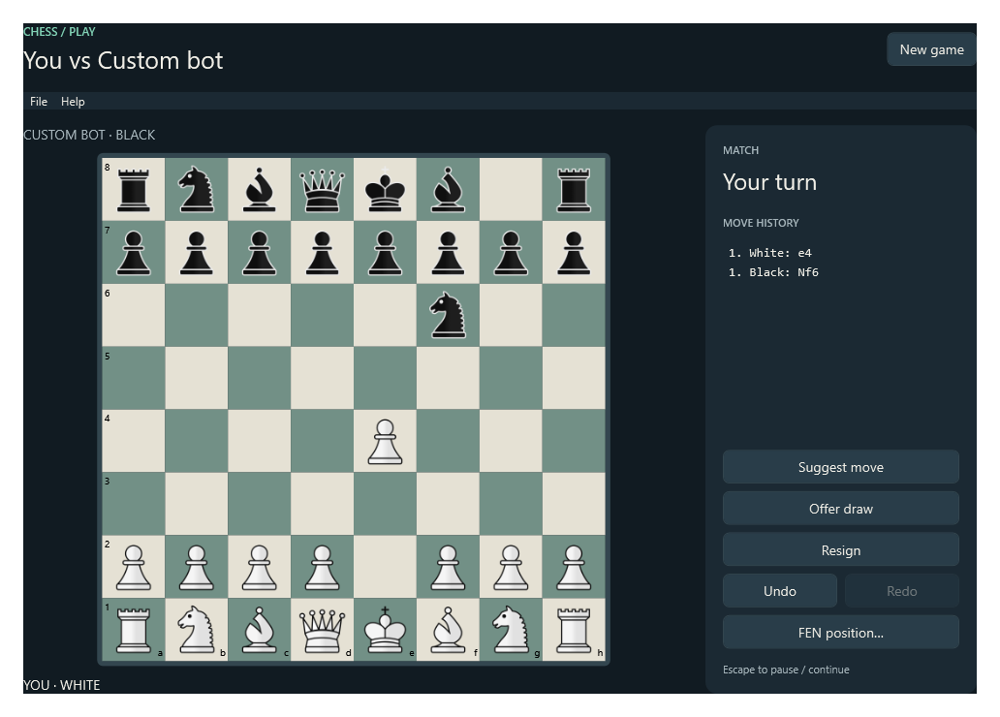

# Tournament interface

The Windows UI implements the approved [Figma C direction](https://www.figma.com/design/kZvgLU33gETM4Hn66bSyHx?node-id=4-1674).

Later Tournament II and Folio Figma explorations are review drafts; they have not
replaced the implemented Tournament C interface.

Setup pairs a plain opponent/colour form with the real starting board. The selected
choice has a brass underline; the start action names the chosen side. Open saved
game loads a complete save into that mode. A failed load leaves setup available.

Both screens use a warm-to-cool charcoal gradient and faint overlapping square outlines.
The match header shows the matchup and navigation, with no CHESS wordmark. Board
coordinates sit outside the squares and follow the selected orientation. Move history
uses paired SAN columns, including positions that begin on Black's turn.

The implementation keeps file/PGN tools in a compact File menu and makes draw/resume
controls conditional. Actions scroll at smaller window sizes so history stays usable.
Bot replies, suggestions, undo/redo, pause, and result menus retain their game behavior.

Libre Baskerville, IBM Plex Sans, and IBM Plex Mono are embedded in the application.
Their SIL Open Font License notices are included in `ChessUI/Assets/Fonts` and copied
to published builds. The piece PNGs are the same source assets used in Figma.
