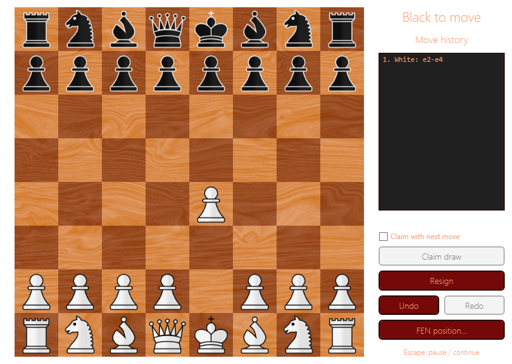

# Undo and redo



Use **Undo** or **Ctrl+Z** to take back the last action. Use **Redo**, **Ctrl+Y**, or
**Ctrl+Shift+Z** to restore it. Each move is one action, including castling, en passant,
and promotion. A resignation or draw claim is a separate action: undo reopens the same
position before taking back any earlier move.

Undo/redo restores the board, turn, piece movement flags, castling rights, en passant,
both move counters, move history, repetition counts, and game result. Undoing an automatic
ending takes back the move that caused it. Redoing that move shows the result again.
Undoing an intended-move draw claim does not play that move.

The controls work during play and from pause or result menus. Navigation closes the
previous overlay and shows the restored position or result. It also clears piece selection,
move highlights, and pending draw-claim controls.

History navigation is disabled while a promotion choice or FEN dialog is open.
In the FEN text box, undo and redo continue to edit text instead of moving through the game.

Playing a new move, resigning, or claiming a draw after undo discards the redo branch.
Rejected moves and invalid draw claims leave it intact. Restarting or loading FEN creates
a new timeline. A terminal position loaded directly from FEN has no earlier move to undo.
Navigation history stays in memory and is not included in FEN or saved to disk.

## Code API

```csharp
if (game.CanUndo) game.Undo();
if (game.CanRedo) game.Redo();
```

`Undo()` and `Redo()` return `false` when no action is available; the game is unchanged.
Successful actions preserve the existing `Board` and read-only `History` collection objects.
Individual piece objects may be replaced during restoration. Direct edits to `Board` are
not recorded; use `ApplyMove`, `Resign`, and `ClaimDraw` for tracked actions.

The regression suite covers special moves in both directions, promotion captures, repetition
and clock thresholds, draw claims, resignation, checkmate, stalemate, branching, controls,
and routed commands. Run it with `dotnet test src/Chess.sln --configuration Release`.
